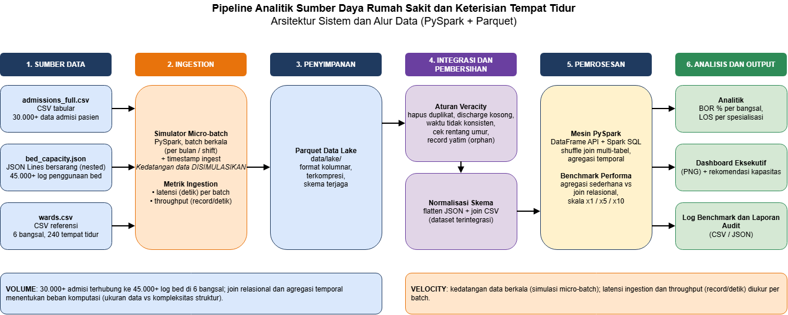

# Hospital Resource & Bed Occupancy Analytics Pipeline
### Scalable Healthcare Data Engineering & Analytics Prototype using the 5Vs Big Data Architecture

[](https://spark.apache.org/)
[](https://www.python.org/)
[](https://parquet.apache.org/)
[](https://spark.apache.org/sql/)


---

## 🏥 Executive Overview

**Hospital Resource & Bed Occupancy Analytics** adalah prototype data pipeline berskala besar yang dirancang untuk mengatasi tantangan operasional rumah sakit modern: **manajemen kapasitas tempat tidur dan alokasi sumber daya medis secara tepat waktu**.

Dalam operasional layanan kesehatan, ketidakseimbangan antara laju admisi pasien dan kapasitas bangsal (khususnya unit rawat intensif seperti ICU) sering menyebabkan *bottleneck*, waktu tunggu pasien membengkak, dan utilisasi fasilitas yang tidak merata. Proyek ini mengimplementasikan arsitektur pemrosesan data terdistribusi berbasis **Apache Spark** untuk mengintegrasikan data admisi, memvalidasi integritas data, dan menghitung indikator kritis rumah sakit seperti **Bed Occupancy Rate (BOR)** serta **Length of Stay (LOS)**.

---

## 🎯 Problem Statement & Analytics Scope

Proyek ini menjawab kebutuhan komputasi analitik berikut:
> *"Bagaimana mengintegrasikan aliran data admisi multi-format, mendeteksi anomali pencatatan log rumah sakit, dan memproyeksikan tingkat keterisian tempat tidur (BOR) secara efisien guna mencegah overcapacity pada bangsal kritis?"*

### Pertanyaan Analitik Utama:
1. **Capacity Thresholds:** Bangsal mana yang melampaui ambang batas ideal BOR (75%–85%) dan berisiko mengalami kelangkaan tempat tidur?
2. **Seasonal Variance:** Bagaimana pola fluktuasi admisi sepanjang tahun mempengaruhi kebutuhan tempat tidur aktif?
3. **Turnaround & Length of Stay:** Bagaimana korelasi antara jenis tindakan/bangsal rawat inap dengan lama hari rawat pasien?

---

## ⚙️ The 5Vs Big Data Architecture

Sistem ini dirancang dengan menerapkan prinsip **5Vs of Big Data**:

```
                       THE 5Vs ARCHITECTURE
┌──────────────────────────────────────────────────────────────────┐
│  1. VOLUME    │ 30.000+ Rawat Inap & 45.000+ Log Utilisasi       │
│  2. VELOCITY  │ Simulasi Micro-batch Ingestion & Latency Profiling│
│  3. VARIETY   │ Integrasi Multi-Format: Tabular CSV + Nested JSON │
│  4. VERACITY  │ Automated Data Quality Cleansing & Validation    │
│  5. VALUE     │ Bed Occupancy Rate, LOS, & Capacity Forecasting  │
└──────────────────────────────────────────────────────────────────┘
```

### 1. Volume (Scale & Computational Complexity)
* Pemrosesan lebih dari **30.000 data admisi pasien** yang berelasi dengan **45.000+ log audit tempat tidur** di 6 bangsal rumah sakit (total kapasitas 240 tempat tidur terpasang).
* Evaluasi komputasi relasional kompleks (*multi-table shuffle joins* dan agregasi temporal) dibandingkan dengan agregasi sederhana pada berbagai skala data ($x1$, $x5$, $x10$).

### 2. Velocity (Data Arrival & Ingestion Timeliness)
* Simulasi aliran data berkala (*periodic batch ingestion*) per periode bulan/shift.
* Pipeline mencatat metrik latensi penulisan (*ingestion latency*) ke Parquet Data Lake dan menghitung *system throughput* (catatan data per detik).

### 3. Variety (Heterogeneous Data Integration)
* Menangani dan mengintegrasikan dua format data dengan skema berbeda:
  * **Tabular Relational (CSV):** Data demografi dan peristiwa admisi pasien (`admissions_full.csv`).
  * **Semi-structured Hierarchical (Nested JSON Lines):** Spesifikasi alkes dan status keterisian bed (`bed_capacity.json`).
  * **Master Reference (CSV):** Tabel kapasitas resmi bangsal (`wards.csv`).

### 4. Veracity (Data Quality & Integrity Management)
* Pipeline mendeteksi dan melakukan koreksi otomatis terhadap anomali pencatatan:
  * *Missing discharge timestamps* pada admisi aktif.
  * *Temporal inconsistency* (waktu keluar sebelum waktu masuk).
  * Standarisasi format penamaan bangsal dan departemen (*casing & whitespace normalization*).
  * Validasi nilai batas wajar umur pasien dan eliminasi catatan duplikat (*deduplication*).
  * Deteksi rekaman yatim (*orphan records*) pada relasi log bed terhadap ID admisi.

### 5. Value (Actionable Healthcare Intelligence)
* Menghasilkan metrik operasional terukur:
  * Kalkulasi harian **Bed Occupancy Rate (BOR %)** per bangsal.
  * Distribusi rata-rata **Length of Stay (LOS)** per spesialisasi medis.
  * Rekomendasi manajerial untuk alokasi tempat tidur fleksibel (*surge capacity*) saat musim puncak.

---

## 🏛️ System Pipeline Workflow & Architecture Diagram

Berikut adalah arsitektur sistem end-to-end yang mengintegrasikan seluruh alur data dari sumber heterogen hingga penyajian informasi bernilai klinis:



> 💡 **File Sumber Diagram:** Diagram arsitektur di atas tersimpan dalam folder [`architectureanddataflow/`](architectureanddataflow/) dalam dua format:
> * **File gambar resolusi tinggi:** [`architectureanddataflow/Arsitektur_BigData_Hospital_Utilisation.drawio.png`](architectureanddataflow/Arsitektur_BigData_Hospital_Utilisation.drawio.png)
> * **File desain editable (Draw.io / diagrams.net):** [`architectureanddataflow/Arsitektur_BigData_Hospital_Utilisation.drawio`](architectureanddataflow/Arsitektur_BigData_Hospital_Utilisation.drawio)

### Rincian 6 Tahapan Arsitektur:

1. **1. Sumber Data (Heterogeneous Sources)**
   * **`admissions_full.csv` (CSV tabular):** Mencatat 30.000+ data admisi pasien rawat inap beserta departemen dan diagnosis klinis.
   * **`bed_capacity.json` (JSON Lines nested):** Mencatat 45.000+ log audit penggunaan tempat tidur, spesifikasi alkes (*ventilator*), dan status keterisian.
   * **`wards.csv` (CSV referensi):** Master data kapasitas resmi 6 bangsal (total 240 tempat tidur) dan batas target BOR (75%–85%).

2. **2. Ingestion (Micro-batch Simulator)**
   * Mensimulasikan pola kedatangan data berkala (*periodic batch arrivals* per bulan/shift) menggunakan PySpark.
   * Menghitung metrik *Velocity*: latensi pencatatan (*latency* dalam detik) dan kecepatan proses (*throughput* dalam record/detik) per batch.

3. **3. Penyimpanan (Raw Parquet Lake)**
   * Data mentah hasil ingest disimpan ke format kolumnar terkompresi **Apache Parquet** di `data/lake/` untuk menjaga keaslian skema dan efisiensi I/O.

4. **4. Integrasi dan Pembersihan Data (Veracity & Normalization)**
   * **Aturan Veracity:** Otomatisasi pembersihan anomali data (eliminasi duplikasi, pengisian discharge kosong, koreksi timestamp keluar < masuk, validasi batas umur logis, dan penanganan record yatim/orphan).
   * **Normalisasi Skema:** Pemipihan (*flattening*) struktur hirarkis JSON dan relasional *join* dengan CSV menjadi dataset terintegrasi.

5. **5. Pemrosesan Data & Benchmarking (PySpark Processing Engine)**
   * Pemrosesan terdistribusi menggunakan PySpark DataFrame API dan Spark SQL Catalyst Optimizer untuk *multi-table shuffle joins* dan agregasi temporal.
   * **Benchmark Performa Komputasi:** Menguji Operasi A (*Simple Aggregation*) versus Operasi B (*Relational & Temporal Analysis*) pada berbagai skala data ($x1$, $x5$, $x10$).

6. **6. Analisis dan Output (Healthcare Value Delivery)**
   * **Analitik Klinis:** Kalkulasi indikator harian **Bed Occupancy Rate (BOR %)** per bangsal dan **Length of Stay (LOS)** per spesialisasi medis.
   * **Dashboard Eksekutif:** Visualisasi grafik ringkasan kapasitas operasional rumah sakit (PNG) beserta rekomendasi manajemen tempat tidur.
   * **Log & Audit:** Pencatatan log benchmark performa query (CSV/JSON) dan laporan arsitektur sistem.

---

## 📂 Repository Structure

```text
BigData-Hospital-Resource-Utilisation/
├── architectureanddataflow/                           # Diagram arsitektur sistem & alur data pipeline
│   ├── Arsitektur_BigData_Hospital_Utilisation.drawio      # File sumber editable (Draw.io / diagrams.net)
│   └── Arsitektur_BigData_Hospital_Utilisation.drawio.png  # Gambar resolusi tinggi diagram arsitektur
├── data/
│   ├── raw/                                           # Sumber data mentah heterogen (CSV & JSON)
│   │   ├── admissions_full.csv                        # Data admisi pasien (CSV tabular, 30.000+ baris)
│   │   ├── bed_capacity.json                          # Log audit pemanfaatan bed (Nested JSON, 45.000+ baris)
│   │   ├── wards.csv                                  # Master referensi kapasitas 6 bangsal (CSV)
│   │   └── DATA_DICTIONARY.md                         # Kamus data lengkap & dokumentasi struktur
│   ├── incoming/                                      # Folder staging simulasi kedatangan batch (Velocity)
│   ├── lake/                                          # Parquet Data Lake mentah hasil ingestion
│   └── clean/                                         # Dataset bersih & terintegrasi (Parquet)
├── results/                                           # Output analitik, log benchmark, & dashboard visual
│   └── 01_profile.json                                # Profil dataset & ringkasan anomali kualitas data
├── config.py                                          # Konfigurasi path, skema PySpark, & utilitas bersama
├── 01_generate_data.py                                # Skrip generator dataset sintetis & injektor anomali
├── requirements.txt                                   # Spesifikasi pustaka Python yang dibutuhkan
├── IFB-451 BIG DATA-Midterm Assignment-DrEdiNuryatno__2026 (1).pdf # Panduan penugasan resmi ETS IFB-451
└── README.md                                          # Dokumentasi teknis proyek
```

---

## 👥 Engineering & Analytics Team

Pembagian peran tim disusun sesuai rubrik penugasan video 5 menit penugasan ETS IFB-451:

| Role | Responsibility Focus | 5Vs Domain | Alur Arsitektur & Modul |
|:---|:---|:---:|:---:|
| **Project Lead / Solution Analyst** | Problem framing, domain requirements, dataset architecture & 5Vs overview | All 5Vs | Tahap 1 (Sumber Data) &bull; Modul M1 |
| **System Engineer** | Periodic micro-batch simulator, lake storage, & velocity tracking | Volume & Velocity | Tahap 2 & 3 (Ingestion & Lake) &bull; Modul M2 |
| **Data Engineer** | Schema transformation, multi-format integration, & veracity cleansing | Variety & Veracity | Tahap 3 & 4 (Cleaning & Integrasi) &bull; Modul M3–M4 |
| **Big Data Developer** | Distributed processing, shuffle join evaluation, & computational benchmarking | Volume & Velocity | Tahap 5 (Pemrosesan PySpark) &bull; Modul M5–M6 |
| **Data Analyst** | Spark SQL analytics, BOR & LOS calculations, dashboard visualization, & healthcare insights | Veracity & Value | Tahap 6 (Analisis & Output) &bull; Modul M7 |

---

## 🚀 Quickstart & Execution

### 1. Prerequisites
* **Python**: 3.10 atau versi di atasnya
* **Java**: JRE / JDK 8, 11, 17, atau 21 (diperlukan oleh runtime Apache Spark)

### 2. Dependency Setup
Pasang dependensi Python yang dibutuhkan:
```bash
pip install -r requirements.txt
```

### 3. Generate Raw Datasets & Anomaly Profile
Jalankan modul pembuatan dataset sintetis berskala besar:
```bash
python 01_generate_data.py
```
Skrip ini akan membuat data mentah heterogen di folder `data/raw/` dan ringkasan profil di `results/01_profile.json`.
